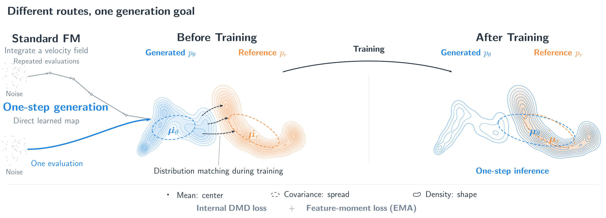
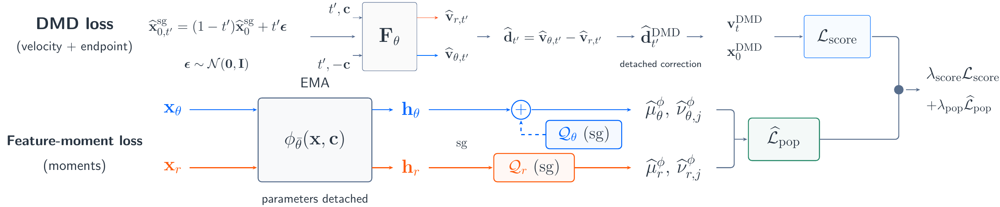
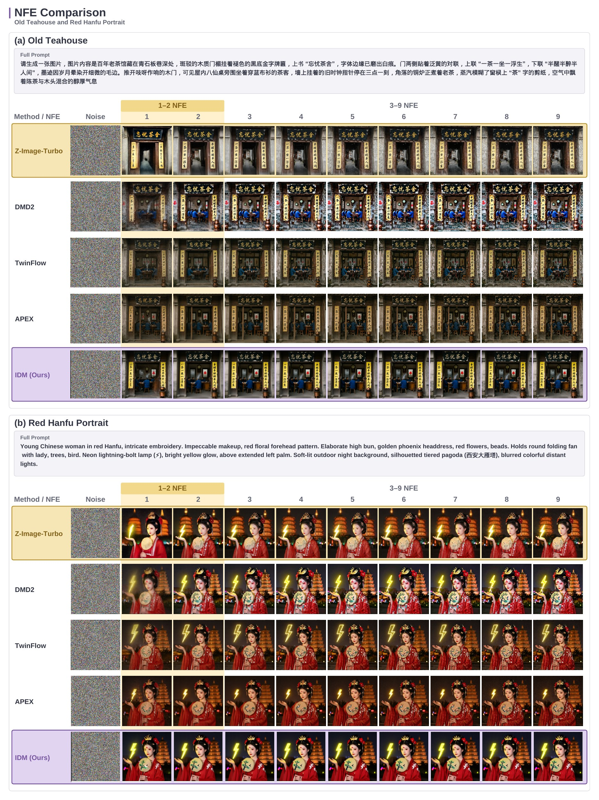

<h1 align="center">IDM</h1>
<p align="center"><b>Intrinsic Distribution Matching</b></p>

<p align="center">
Deyuan Liu<sup>†</sup> · Yansen Han<sup>†</sup> · Kaiwen Zheng<sup>†</sup> · Jun Xie · Jiacheng Liu<br>
Zhenglin Cheng · Peng Sun · Jintao Zhang<sup>*</sup> · Jianguo Li<sup>*</sup> · Tao Lin<sup>*</sup>
</p>
<p align="center">
<b>Inclusion AI</b> · Westlake University · Tsinghua University<br>
Zhejiang University · Shanghai Innovation Institute · MBZUAI
</p>
<p align="center">
<sup>†</sup> Equal contribution &nbsp; <sup>*</sup> Corresponding authors
</p>
<p align="center">
<a href="https://inclusionai.github.io/IDM/"></a>
<a href="https://arxiv.org/abs/2610.39633"></a>
<a href="https://huggingface.co/papers/2610.39633"></a>
<a href="paper/IDM.pdf"></a>
</p>
<p align="center">
<a href="#core-results">Results</a> ·
<a href="#method">Method</a> ·
<a href="#inference">Inference</a> ·
<a href="#checkpoints">Checkpoints</a>
</p>
<p align="center">
<a href="#checkpoints"></a>
</p>

**IDM improves one-step and few-step text-to-image generation by combining internal distribution matching distillation (DMD) with moment matching in the generator's own EMA feature space.** No external feature encoder is required. The same trained checkpoint supports both 1-NFE and 2-NFE sampling.

<p align="center">

<br><em>IDM (Z-Image), 2 NFE. Samples from the paper.</em>
</p>

## Core results

- **Long-text rendering:** 94.25% on LongText-CN and 90.20% on LongText-EN at 2 NFE, the highest scores among the methods compared at this budget.
- **Fast generation:** full-parameter IDM (Z-Image) takes 0.25 s at 1 NFE and 0.30 s at 2 NFE; IDM (Qwen-Image) takes 0.35 s and 0.44 s, respectively, on a single A100 in BF16.
- **Useful internal features:** adding EMA feature-moment matching improves all five reported aggregate metrics over the shared internal DMD control. Its results are close to those obtained with DINOv2 features.

All values below are reported in the paper. They are not measurements from running this repository.

### Long-text rendering and general quality

Z-Image comparisons at 2 NFE. All scores are percentages; higher is better.

| Method | NFE | OneIG | GenEval | DPG-Bench | LongText-CN | LongText-EN |
| --- | ---: | ---: | ---: | ---: | ---: | ---: |
| Z-Image-Turbo | 2 | 50.94 | 76.53 | 85.78 | 78.48 | 72.89 |
| DMD2 | 2 | 50.70 | 76.12 | 85.40 | 85.30 | 80.99 |
| TwinFlow | 2 | 51.38 | 72.41 | 85.98 | 78.65 | 71.99 |
| APEX | 2 | 52.60 | 77.23 | **88.64** | 90.38 | 88.76 |
| Z-Image-Turbo++ | 2 | 52.50 | 75.70 | 85.86 | 91.62 | 89.88 |
| **IDM** | **2** | **53.06** | **77.81** | 86.82 | **94.25** | **90.20** |
| Z-Image-Turbo (higher-NFE reference) | 8 | 52.84 | 75.01 | 84.86 | 92.56 | 91.74 |

At 2 NFE, IDM improves LongText-CN/EN over Z-Image-Turbo++ by **2.63 / 0.32 percentage points**, and over APEX by **3.87 / 1.44 points**. The 8-NFE reference retains a higher LongText-EN score. Published reference models have different training settings and data; APEX also scores higher on DPG-Bench. The controlled ablations below measure the contribution of IDM's individual components within a shared setting.

### Quality and efficiency across both backbones

Selected results from the paper's system-level comparison. Throughput uses batch size 10; latency uses batch size 1, both on a single A100 in BF16. LoRA weights are merged before timing. FID is lower-is-better; CLIP and GenEval are higher-is-better. GenEval here uses the paper's 0–1 scale.

| Backbone | Tuning | NFE | FID ↓ | CLIP ↑ | GenEval ↑ | Latency (s) ↓ | Throughput (images/s) ↑ |
| --- | --- | ---: | ---: | ---: | ---: | ---: | ---: |
| Z-Image-Turbo 6B | Full | 1 | 7.13 | 28.37 | 0.77 | 0.25 | 5.41 |
| Z-Image-Turbo 6B | Full | 2 | 6.71 | 28.22 | 0.78 | 0.30 | 5.18 |
| Z-Image-Turbo 6B | LoRA r=64 | 2 | 6.79 | 28.13 | 0.77 | 0.30 | 5.18 |
| Qwen-Image 20B | Full | 1 | 6.77 | 28.71 | 0.90 | 0.35 | 3.44 |
| Qwen-Image 20B | Full | 2 | 6.34 | 28.56 | 0.91 | 0.44 | 3.28 |
| Qwen-Image 20B | LoRA r=64 | 2 | 6.41 | 28.47 | 0.90 | 0.44 | 3.28 |

The full Qwen-Image model also reaches **87.16% DPG-Bench** and **0.56 WISE** at 2 NFE. Rank-64 LoRA updates 0.4B parameters and retains most of the full model's GenEval performance.

### What does the added moment loss contribute?

Controlled ablations use full-parameter IDM (Z-Image) at 2 NFE, with the same data and training configuration. All values are percentages.

| Configuration | OneIG | GenEval | DPG-Bench | LongText-CN | LongText-EN |
| --- | ---: | ---: | ---: | ---: | ---: |
| Without DMD or feature-moment loss | 52.25 | 76.24 | 85.68 | 92.70 | 88.88 |
| Without DMD loss | 52.58 | 76.90 | 86.15 | 93.33 | 89.62 |
| Internal DMD, without feature-moment loss | 52.87 | 77.46 | 86.54 | 93.87 | 89.79 |
| DMD + moment loss with DINOv2 features | 53.00 | 77.75 | 86.71 | 94.13 | 90.09 |
| **IDM: DMD + moment loss with generator EMA features** | **53.06** | **77.81** | **86.82** | **94.25** | **90.20** |

Adding the EMA feature-moment loss to the internal DMD control gives **+0.19 OneIG, +0.35 GenEval, +0.28 DPG-Bench, +0.38 LongText-CN, and +0.41 LongText-EN**. DINOv2 features also improve the control; the small differences support the use of the generator's own representation without requiring an external encoder.

### Why combine velocity and endpoint regression?

The choice is empirical. With feature-moment matching retained in every row, equal-weight velocity + endpoint regression leads on all five aggregate metrics.

| DMD regression | OneIG | GenEval | DPG-Bench | LongText-CN | LongText-EN |
| --- | ---: | ---: | ---: | ---: | ---: |
| Velocity only | 52.43 | 76.64 | 85.93 | 93.03 | 89.17 |
| Endpoint only | 52.78 | 77.26 | 86.42 | 93.71 | 89.74 |
| 2 × endpoint + velocity | 53.01 | 77.71 | 86.75 | 94.17 | 90.13 |
| Endpoint + 2 × velocity | 52.95 | 77.59 | 86.66 | 94.05 | 90.04 |
| **Endpoint + velocity** | **53.06** | **77.81** | **86.82** | **94.25** | **90.20** |

These regressions apply different time weightings to the same detached DMD correction. They do not provide two independent sources of distributional information.

## Method

<p align="center">

</p>

DMD uses a score difference between generated and reference distributions to supervise a fast generator. Following APEX, IDM obtains this difference from internal velocity branches, avoiding a separate fake-score network.

A Gaussian-plus-residual decomposition of the reverse-KL field motivates an explicit constraint on moments. IDM keeps the **full DMD correction** and adds a loss matching the **means and per-coordinate standard deviations** of features from the generator's EMA copy. Moment matching complements the score correction; it does not replace the residual part of the distributional signal.

<p align="center">

</p>

At inference, only the learned conditional generator, text encoder, and VAE are needed. No moment computation, feature queue, external encoder, or fake-score evaluation is performed.

## Visual comparisons

<p align="center">

</p>

In these examples, full IDM preserves dense text more consistently across 1 and 2 NFE. The velocity + endpoint control without the moment loss produces more saturated colors in parts of the sushi poster. APEX is an external reference trained on a smaller collection; the IDM controls share one training setting.

<details>
<summary>Comparison across sampling budgets</summary>



Each column shows a final output at the indicated NFE budget, not an intermediate state of a single sampling trajectory.

</details>

## Checkpoints

**Coming soon.** Download links and checkpoint-specific sampling settings will be added with the weight release.

| Backbone used in the paper | Full parameters | LoRA r=32 / r=64 |
| --- | --- | --- |
| Z-Image-Turbo 6B | Coming soon | Coming soon |
| Qwen-Image 20B | Coming soon | Coming soon |

The loader accepts a local Diffusers pipeline or a Hugging Face repository, an optional transformer-only checkpoint, and Diffusers-format LoRA weights. Base-model or APEX weights are not IDM checkpoints; they do not reproduce the IDM results above.

## Inference

### Install

Use Python 3.10 or newer and a CUDA machine with enough memory for the selected model. The default precision is BF16. The 20B backbone requires substantially more memory than the 6B model. This entry point loads the text encoder, transformer, and VAE on the selected device.

```bash
python -m venv .venv
source .venv/bin/activate
python -m pip install -r requirements.txt
```

Install a PyTorch build appropriate for your CUDA environment if needed. FlashAttention, FSDP, and training services are not required. Diffusers is pinned because the auxiliary-time wrappers use its model interfaces.

### Generate an image

Once an IDM checkpoint is available, set its path through `--model`:

```bash
python inference.py \
  --backbone z-image \
  --model /path/to/IDM-Z-Image \
  --prompt 'A cafe menu with the heading "MORNING COFFEE" and three lines: "Americano $4", "Latte $5", "Mocha $6".' \
  --steps 2 --height 1024 --width 1024 --seed 42 \
  --output-dir outputs/z-image
```

```bash
python inference.py \
  --backbone qwen-image \
  --model /path/to/IDM-Qwen-Image \
  --prompt '一张咖啡馆海报，标题“今日咖啡”，三行菜单“美式咖啡 18元”“拿铁咖啡 22元”“摩卡咖啡 25元”。' \
  --steps 1 --height 1024 --width 1024 --seed 42 \
  --output-dir outputs/qwen-image
```

Each output includes a PNG and a JSON file containing the prompt, seed, weight paths, and sampling configuration. Existing outputs are not overwritten.

- `--steps 1` or `--steps 2` performs exactly one or two conditional transformer evaluations, without classifier-free guidance.
- Height and width must be positive multiples of 16.
- `--device cuda:1` selects another GPU. CPU is available for small compatibility checks.
- `--prompt-file examples/prompts.txt --num-images 2` runs each nonempty prompt twice, incrementing the seed for every image.
- `--local-files-only` disables model downloads and uses local files or an existing Hugging Face cache.
- Run `python inference.py --help` for the complete argument list.

The default sampler is deterministic first-order Euler: noise levels `[1]` or `[1, 0.5]`, followed by the clean endpoint at 0. Custom schedules can be supplied with `--timesteps`, and optional noise refresh with `--stochastic-ratio`. These are configurable inference defaults; checkpoint-specific settings and end-to-end quality validation are pending the weight release.

### Load a transformer-only checkpoint

Use the corresponding base pipeline for its tokenizer, text encoder, and VAE, and point `--transformer` at the exported IDM transformer directory. That directory must contain `config.json` and safetensors weights.

```bash
python inference.py \
  --backbone z-image \
  --model /path/to/Z-Image-Turbo \
  --transformer /path/to/IDM-transformer \
  --prompt 'A book cover titled "The Art of Calm".' \
  --steps 2
```

`--aux-time-embed auto` selects the auxiliary-time wrapper when the checkpoint's `_class_name` identifies it. For older exports, use `--aux-time-embed on` or `off` to match the checkpoint architecture. Missing or unexpected transformer parameters cause an error instead of silently leaving random weights in the model.

### Load LoRA weights

```bash
python inference.py \
  --backbone qwen-image \
  --model /path/to/Qwen-Image \
  --lora /path/to/IDM-LoRA \
  --lora-weight-name pytorch_lora_weights.safetensors \
  --prompt 'A poster with the title "Explore Japan".' \
  --steps 2 --output-dir outputs/lora
```

The adapter must use the Diffusers pipeline LoRA format and match its base model. The default filename is `pytorch_lora_weights.safetensors`; use `--lora-weight-name` for a different filename. It is merged at load time; `--lora-scale` defaults to 1.0. Raw optimizer states, FSDP shards, and unconverted PEFT training checkpoints are not inference inputs.

## Repository layout

```text
inference.py              Command-line image generation
unified_sampler.py        One- and two-evaluation first-order sampling
diffusers_patch/          Inference adapters and auxiliary-time model wrappers
examples/prompts.txt      English and Chinese prompt examples
assets/                   Figures from the IDM paper
tests/                    CPU checks with small models; no model downloads
```

For development checks:

```bash
python -m pip install -r requirements-dev.txt
python -m pytest -q
ruff check .
```

## Citation

If you use this code, please cite IDM and APEX:

```bibtex
@misc{liu2026intrinsicdistributionmatching,
  title={Intrinsic Distribution Matching},
  author={Deyuan Liu and Yansen Han and Kaiwen Zheng and Jun Xie and Jiacheng Liu and Zhenglin Cheng and Peng Sun and Jintao Zhang and Jianguo Li and Tao Lin},
  year={2026},
  eprint={2610.39633},
  archivePrefix={arXiv},
  primaryClass={cs.CV},
  url={https://arxiv.org/abs/2610.39633},
}

@article{liu2026self,
  title={Self-Adversarial One Step Generation via Condition Shifting},
  author={Liu, Deyuan and Sun, Peng and Han, Yansen and Cheng, Zhenglin and Chen, Chuyan and Lin, Tao},
  journal={arXiv preprint arXiv:2604.12322},
  year={2026}
}
```

## Acknowledgments and license

The inference implementation is adapted from [APEX](https://github.com/LINs-lab/APEX), which builds on [TwinFlow](https://github.com/inclusionAI/TwinFlow), [RCGM](https://github.com/LINs-lab/RCGM), and [UCGM](https://github.com/LINs-lab/UCGM). We use model components from [Hugging Face Diffusers](https://github.com/huggingface/diffusers).

Code is distributed under [Apache 2.0](LICENSE). Base-model and future IDM checkpoint licenses apply separately to the weights. The project page uses [KaTeX](https://katex.org/) under the [MIT license](docs/vendor/katex/LICENSE).
